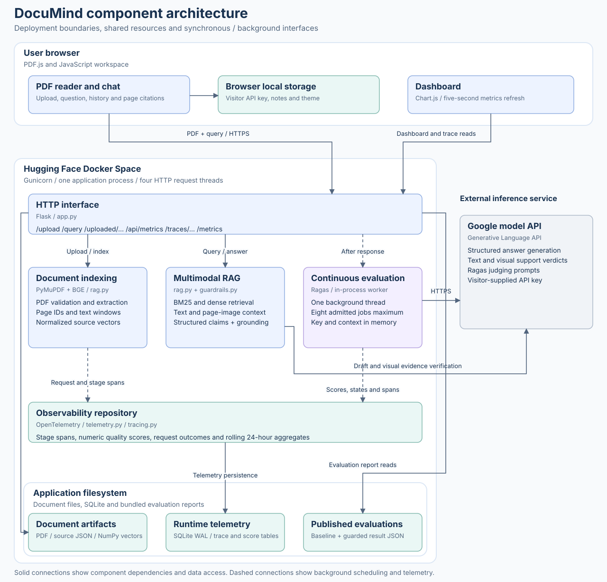
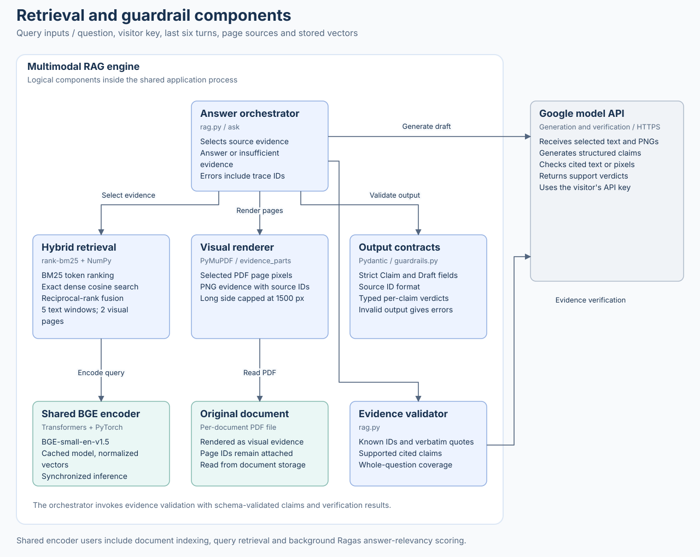

# DocuMind

**Multimodal document question answering with evidence checks, continuous RAG evaluation, and live observability.**

DocuMind combines a PDF reader with a conversational assistant. It retrieves relevant text and visual pages, generates answers with page citations, and reports insufficient evidence when the document cannot support a response. A live dashboard tracks request performance, guardrail decisions, and RAG quality as users ask questions.

[Live application](https://avish006-documind.hf.space) · [Live dashboard](https://avish006-documind.hf.space/dashboard) · [Hugging Face Space](https://huggingface.co/spaces/Avish006/DocuMind) · [Evaluation methodology](evals/README.md) · [Metrics reference](docs/metrics.md)

## Features

- **Multimodal retrieval** — combines BGE embeddings and BM25 to select text passages and visual pages. Rendered page images let the model inspect charts, figures, diagrams, and table layouts.
- **Evidence-backed answers** — validates source IDs, checks quoted text, and verifies individual claims against cited text or page images.
- **Explicit abstention** — reports insufficient evidence when an answer lacks support.
- **Continuous evaluation** — runs Ragas answer relevancy and text faithfulness checks in the background on delivered answers.
- **Live observability** — provides traffic and error rates, latency percentiles, stage timings, provider tokens and estimated cost, guardrail outcomes, quality trends, and clickable OpenTelemetry traces.
- **Document workspace** — includes a resizable PDF/chat layout, navigation from citations, dark and light themes, Markdown and math rendering, and browser-local notes with export.

## Try the application

1. Open DocuMind and enter a Google API key through **Settings**.
2. Upload a readable PDF of up to **50 MB**.
3. Ask a question, then select a page citation to inspect its supporting evidence.
4. Open the chart icon in the header to view the dashboard.

Create or view your key in Google AI Studio. [Google AI Studio](https://aistudio.google.com/apikey)

The included Harbor pilot PDF demonstrates both a figure question and an unanswerable question. [Download the sample PDF](evals/fixtures/harbor.pdf)

| Question | Expected behavior |
| --- | --- |
| “In Figure 1, how many crates did the west dock handle?” | Answers 42 crates and cites page 2 |
| “How many workers unloaded those crates?” | Reports insufficient evidence |

## Architecture

### Components and deployment boundaries

The browser communicates with a Flask application running in one Gunicorn process. Document indexing, question answering, tracing, and a background evaluation thread share that process. The diagram shows their dependencies, storage ownership, and external API connections.



The dashboard reads live aggregates from SQLite through `/api/metrics` every five seconds. Monitoring tools can scrape `/metrics`, and individual requests expose their stage spans through `/traces/<id>`. Published evaluation reports are loaded from bundled JSON files.

### Retrieval and guardrail components



The embedding model is shared by indexing, query retrieval, and Ragas relevancy scoring. Ragas evaluates delivered answers asynchronously with the visitor's Google key. Labeled evaluation runs use the same RAG modules through the CLI and write the JSON reports consumed by the dashboard.

### Retrieval and generation

PyMuPDF extracts text into 900-character windows with 150-character overlap. Each source retains its page number and source ID. Pages containing embedded images or vector drawings also become visual sources.

The retriever combines normalized BGE vector rankings with BM25 rankings using reciprocal ranks. It selects up to five text windows and two visual pages. Exact dense search uses NumPy. Selected visual pages are rendered to images and sent to the Google model alongside the retrieved text. The last six conversation turns help resolve follow-up references.

### Guardrails

Pydantic enforces strict schemas for generated claims and verification results. The server validates each source ID and checks that quoted text appears in its cited source. A separate model call verifies claim support and whether the draft answers the complete question.

Unknown sources, mismatched quotes, and failed evidence checks lead to an insufficient-evidence response. Malformed output and provider failures return a traceable error. Document contents and conversation history are treated as data within generation and verification prompts.

## Technology stack

| Component | Implementation |
| --- | --- |
| Web application | Flask, Gunicorn, HTML, CSS, JavaScript |
| PDF processing | PyMuPDF |
| Embeddings | BAAI/bge-small-en-v1.5 through Transformers and PyTorch |
| Retrieval | BM25 and exact dense vector search with NumPy |
| Generation and verification | Google Generative Language API |
| Output validation | Pydantic |
| RAG evaluation | Ragas 0.3.7 |
| Tracing and metrics | OpenTelemetry, Prometheus client, SQLite |
| Dashboard charts | Chart.js |
| Deployment | Docker on Hugging Face Spaces |

## Evaluation results

The labeled regression suite contains **12 questions across two synthetic PDFs**, with four text questions, four figure questions, and four unanswerable questions. Chart values are present only in image pixels. Both arms use `gemini-3.5-flash-lite` with the same documents, questions, and fresh conversation history.

| Metric | Baseline | Guarded |
| --- | ---: | ---: |
| Answer correctness | 8/12 | 12/12 |
| Citation accuracy, page and evidence | 0/8 | 8/8 |
| Insufficient-evidence recall | 4/4 | 4/4 |
| Abstention accuracy | 8/12 | 12/12 |
| Precision@3 | 16.7% | 33.3% |
| Recall@3 | 50.0% | 100.0% |
| NDCG@3 | 0.500 | 0.750 |
| Context precision, rank-aware AP | 50.0% | 66.7% |
| Context precision, source IDs | 25.0% | 33.3% |
| Context recall, source IDs | 50.0% | 100.0% |
| Mean reciprocal rank | 0.500 | 0.667 |
| Ragas answer relevancy | 98.0%, n=4 | 97.6%, n=8 |
| Ragas text faithfulness | 100.0%, n=4 | 100.0%, n=4 |
| Ragas factual correctness, F1 | 50.0%, n=8 | 58.4%, n=8 |
| Citation evidence support | 0.0%, n=8 | 100.0%, n=8 |

Retrieval metrics average over the eight answerable questions. The guarded pipeline retrieves the required source for every question, while also supplying two other sources per question.

This comparison was rerun on November 27, 2026. Ragas evaluates delivered answers. The baseline delivered four text answers, while the guarded pipeline delivered all eight answerable responses. Their answer relevancy averages therefore cover different question subsets. Text faithfulness covers the same four text questions in both arms. Factual F1 includes zero scores for refusals on answerable questions.

Gold-fact coverage and Ragas factual F1 measure different things. All guarded answers contain the required facts, while the independent Ragas judge gives several of those answers low claim-level scores against the short reference sentences. The reports retain this disagreement. Model-judged correctness is sensitive to claim decomposition and reference wording; inspect individual answers alongside both scores.

These results describe a small English regression suite and the combined effect of retrieval, visual evidence, and answer checks. Broader document performance requires additional evaluation.

[Evaluation protocol](evals/README.md) · [Question labels](evals/cases.json) · [Baseline results](evals/results/baseline.json) · [Guarded results](evals/results/guarded.json)

## Live observability

The dashboard refreshes every **five seconds** over a rolling **24-hour window**.

| Area | Measurements |
| --- | --- |
| Request performance | Total requests, requests per minute, success/error rates, mean/p50/p95/p99 latency, stage timings |
| Provider performance | Token consumption by phase, paid list-price estimates, cost per settled query, upstream TTFT |
| Retrieval | Retrieved source count, cosine similarity, BM25/fused scores, judged context relevance |
| Generation quality | Ragas answer relevancy and text faithfulness |
| Guardrails | Draft claim support, question responsiveness, cited-source share, trigger rate, abstention rate and outcomes |
| Trends | Hourly traffic, latency, and RAG quality |
| Diagnostics | Request trace IDs, stage timings, recent failures, background evaluation status |

The dashboard also reports total recorded requests, requests per minute, success and error rates, mean/p50/p95/p99 latency, stage latency, abstention and guardrail trigger rates, provider tokens, cost estimates, and provider TTFT. Query traces include per-source cosine, BM25 and fused rank scores. [Definitions and formulas](docs/metrics.md)

Every upload and query returns a `trace_id` and an `X-Trace-ID` response header. Select **View trace** in chat or a failure in the dashboard to inspect its OpenTelemetry spans. Quality metrics display their measured sample counts, and traces show evaluation status.

Provider TTFT measures time to the first upstream text chunk. Answers reach the reader after evidence checks. Token usage comes from Google's streaming metadata, and cost is a paid Standard list estimate with coverage counts. Unknown prices and incomplete calls remain unavailable. [Cost basis](docs/metrics.md#usage-and-cost-accounting)

Ragas scoring starts after an answer is delivered. Answer relevancy uses three generated questions and local BGE embeddings. Text faithfulness evaluates answer statements against retrieved text. Figure answers receive a visual support check and remain eligible for answer relevancy scoring.

Background scoring typically adds three Google calls for relevancy and two for text faithfulness, with limited retries. These calls use the visitor's API key and consume its quota. One worker accepts up to eight pending or running jobs in memory. At capacity, scoring is marked skipped busy and the answer still returns. A restart marks unfinished jobs interrupted.

Prometheus can scrape `/metrics` for rolling request counts, p95 latency, score means, sample counts, evaluation status, and guardrail outcomes. [Prometheus endpoint](https://avish006-documind.hf.space/metrics)

## Local development

### Prerequisites

- Python **3.11**
- Git, including for Ragas' GitPython dependency
- A Google API key with access to the configured model
- Internet access for the initial embedding-model download and API requests

### Installation

```bash
git clone https://github.com/avish006/Rag-Project.git
cd Rag-Project
python -m venv .venv
```

Activate the virtual environment using the command for your platform.

| Platform | Command |
| --- | --- |
| Windows PowerShell | `.venv\Scripts\Activate.ps1` |
| Linux or macOS | `source .venv/bin/activate` |

```bash
python -m pip install -r requirements.txt
python app.py
```

The first upload downloads the BGE model unless it is already cached. Enter your API key through the application's Settings dialog. [Open the local application](http://localhost:5000)

### Configuration

Set optional server configuration through process environment variables. The evaluation CLI can also load its Google key from an ignored `.env` file.

| Variable | Default | Purpose |
| --- | --- | --- |
| `DOCUMIND_DATA` | `instance/documind` | Writable document and telemetry directory |
| `DOCUMIND_MODEL` | `gemini-3.5-flash-lite` | Google generation, verification, and evaluation model |
| `DOCUMIND_EMBED_MODEL` | `BAAI/bge-small-en-v1.5` | Embedding-model Hub ID or local directory |
| `GOOGLE_API_KEY` | Unset | Evaluation CLI credential |
| `PORT` | `5000` | Port used by the local Flask entry point |

The web application takes the visitor's API key from the query request. Server-side evaluation credentials are configured separately. [.env example](.env.example)

### Tests and evaluation

```bash
python -m unittest discover -s tests -v
python -m evals.run both
python -m evals.run both --score-recorded
```

The first evaluation command generates the paired answers. The second applies Ragas to recorded answers and preserves completed scores. To keep an experiment separate, pass `--output instance/experiment` to both evaluation commands.

## Deployment

The root Dockerfile builds the application used for local development. It installs the system dependency, warms the embedding model, and checks the application import during the build. Gunicorn runs as UID 1000 on port 7860 with one worker and four threads.

```bash
docker build -t documind .
docker run --rm -p 7860:7860 -v documind-data:/app/instance documind
```

The named volume retains local uploads and telemetry across container replacements.

The Hugging Face Space uses a Dockerfile pinned to a public commit from this repository. Generate it with the deployment helper, then commit the output as the Space's root Dockerfile.

```bash
python deploy/space_file.py <full-github-commit-sha>
```

After deployment, verify `/health`, upload a sample PDF, follow an answer citation, and inspect `/dashboard`. Restore a previous Space Dockerfile revision to roll back a deployment. [Deployment helper](deploy/space_file.py)

## API

| Method | Endpoint | Purpose |
| --- | --- | --- |
| `POST` | `/upload` | Accepts a PDF in multipart field `file`. Returns document ID, PDF URL, and trace ID. |
| `POST` | `/query` | Accepts `query`, `api_key`, `document_id`, and optional `history`. Returns response status, citations, diagnostic, and trace ID. |
| `GET` | `/api/metrics` | Returns live aggregates, recent query traces, failures, hourly trends, and published evaluation scores. |
| `GET` | `/metrics` | Exposes Prometheus metrics. |
| `GET` | `/traces/<id>` | Displays one request's diagnostics, spans, and quality measurements. |
| `GET` | `/evaluations/baseline` | Displays recorded baseline answers and scores. |
| `GET` | `/evaluations/guarded` | Displays recorded guarded answers and scores. |
| `GET` | `/health` | Provides an HTTP liveness check. |

## Data handling and limitations

- **API keys** are remembered in browser local storage and forwarded to Google for generation and evaluation requests. Background scoring retains keys and query data temporarily in memory.
- **Public telemetry** stores numeric scores, statuses, timestamps, and stage timings. Keys, questions, answers, filenames, document IDs, and PDF contents are excluded.
- **Uploaded PDFs** use random bearer URLs. Anyone holding a document URL can read it during its lifetime. Access expires after 24 hours, and subsequent uploads sweep expired files.
- **Trace retention** is seven days, with older traces pruned on writes. Hosts with ephemeral storage can lose documents and runtime metrics after replacement. Published evaluation reports are bundled with the application.
- **Retrieval coverage** is limited to selected passages and visual pages. Long documents and scanned PDFs can require relevant pages that the retriever misses.
- **Model judgments** can share errors because generation, verification, and Ragas scoring use the same model. Ragas text faithfulness measures support in retrieved text. Visual support is assessed through page-image verification.

## Repository structure

| Path | Responsibility |
| --- | --- |
| `app.py` | HTTP routes and request lifecycle |
| `rag.py` | PDF extraction, retrieval, generation, and evidence verification |
| `guardrails.py` | Pydantic contracts for claims and verdicts |
| `ragas_eval.py`, `continuous_eval.py` | Ragas adapters and bounded background scoring |
| `tracing.py`, `telemetry.py`, `rag_metrics.py` | Trace spans, persistence, metric definitions, and export |
| `templates/`, `static/` | Reader and dashboard interfaces |
| `evals/` | Labeled fixtures, runners, methodology, and results |
| `tests/` | Regression tests |
| `deploy/`, `Dockerfile` | Deployment helper and container definition |
